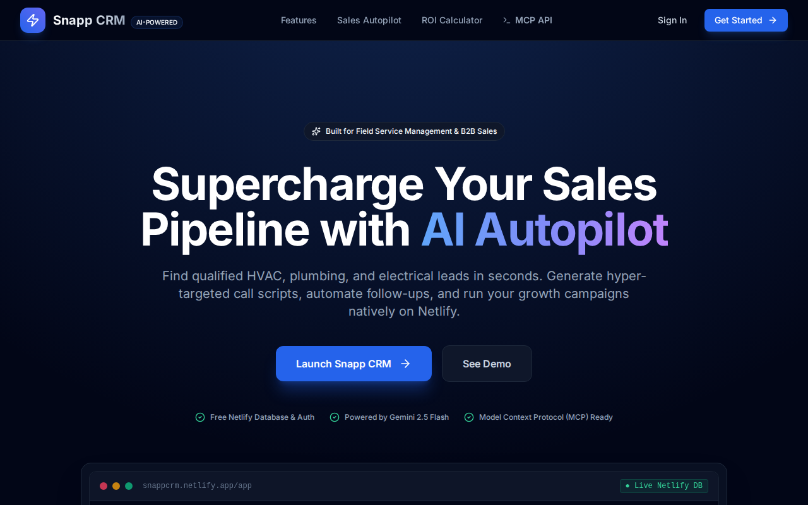

# Snapp CRM



An AI-assisted CRM built for service businesses — automated lead generation, pipeline tracking, and sales planning. The CRM that does the data entry for you instead of making you do it.

**Live at [snappcrm.netlify.app](https://snappcrm.netlify.app)**

## Why this exists

Most CRMs are designed for enterprise sales teams with dedicated sales ops. Service businesses don't have that. The owner is the sales team, the dispatcher, and the technician. They don't have time to log every call, update every stage, or manually research leads.

Snapp CRM flips the model: instead of asking "did you update the CRM today?", it asks "what can I find for you?" The AI lead finder scans for potential customers, the Growth Lab suggests next actions, and Autopilot builds a sales plan you can actually follow.

## What it does

- **AI lead generation** — finds potential customers based on your business type and service area
- **Kanban pipeline** — drag-and-drop lead tracking with custom stages
- **Growth Lab** — guided workflows that suggest next actions for each lead
- **Autopilot** — automated sales planning with task scheduling
- **Map view** — leads plotted on an interactive map with territory visualization
- **List view** — sortable, filterable lead list with bulk actions
- **Multi-user** — Supabase auth with row-level security

## How it's built

- **React 19 + TypeScript + Vite** — frontend with Tailwind CSS
- **Supabase** — auth, Postgres database, row-level security, edge functions
- **Google Gemini** — AI lead finding and suggestions, routed through Supabase Edge Functions (keys never reach the browser)
- **Leaflet** — interactive map with custom markers
- **Netlify** — static hosting + serverless functions

The AI gateway is the interesting piece — all AI calls go through a Supabase Edge Function, so the Gemini API key stays server-side. The frontend never sees it. The function handles prompt construction, response parsing, and error recovery.

## Run it locally

```bash
npm install
cp .env.local.example .env.local   # Add your Supabase + Gemini keys
npm run dev                         # http://localhost:5173
```

For AI features, deploy the edge function:
```bash
npx supabase functions deploy ai-gateway
npx supabase secrets set GEMINI_API_KEY=your_key
```

## License

Proprietary. All rights reserved.
