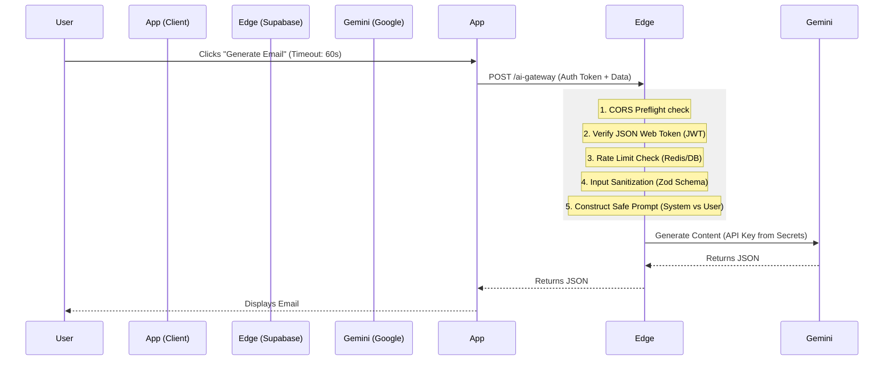

# 🔒 Architecture Plan: Secure AI Gateway (v1.1)

## 🎯 Objective
Migrate all client-side AI operations to a secure backend environment to prevent API Key exposure, enforce user authorization, and mitigate abuse.

## 🏗️ Architecture
**Pattern:** Gateway Proxy with Rate Limiting
**Technology:** Supabase Edge Functions (Deno/TypeScript)

## 🛡️ Security Controls (Updated)

1.  **JWT Verification:** Every request MUST contain a valid Supabase Auth Header. Anonymous requests are blocked (401).
2.  **Secret Management:** `GEMINI_API_KEY` is stored in Supabase Vault, injected only at runtime. Never logged.
3.  **Strict Rate Limiting:**
    *   **Logic:** Users are limited to X requests per minute.
    *   **Implementation:** For MVP, we use a simple database check or lightweight in-memory counter if ephemeral. Long-term: Upstash Redis.
4.  **Input Sanitization & Prompt Injection Defense:**
    *   **Schema Validation:** The request body is validated against a strict Zod schema (e.g., `email` field must be email format, `instruction` length < 500 chars).
    *   **Prompt Structure:** User input is wrapped in XML tags (e.g., `<user_context>...</user_context>`) to separate it from System Instructions.

## 📂 Implementation Details

### 1. The Gateway (`supabase/functions/ai-gateway/index.ts`)
A robust endpoint handling:
- **CORS:** Explicitly handling `OPTIONS` requests to prevent browser blocks.
- **Error Handling:** Returning standard HTTP codes (400 Bad Request, 429 Too Many Requests, 500 Internal Error).
- **Actions:**
  - `find_leads`
  - `generate_script`
  - `generate_email`
  - `generate_social`
  - `analyze_lead`
  - `parse_import`

### 2. The Service Refactor (`frontend`)
The `geminiService.ts` becomes a client wrapper.
**Key Change:**
- Adds `signal: AbortSignal.timeout(60000)` to prevent premature client timeouts on long generations.
- Handles `429` errors by showing a "Please wait a moment" toast.

## ⚠️ Known Limitations / Mitigations
1.  **Cold Starts:** First request might take ~1-2s longer.
    *   *Mitigation:* UI shows "Warming up AI..." state if request > 2s.
2.  **Request Size:** Body limit is 6MB.
    *   *Mitigation:* We will truncate huge import texts on the client side before sending.

## ✅ Approval Status
Plan updated with Engineering & Security feedback. Ready for implementation.
